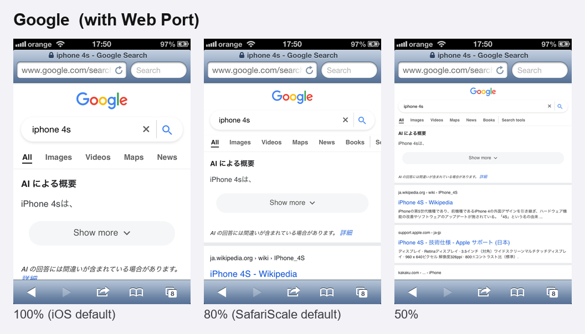
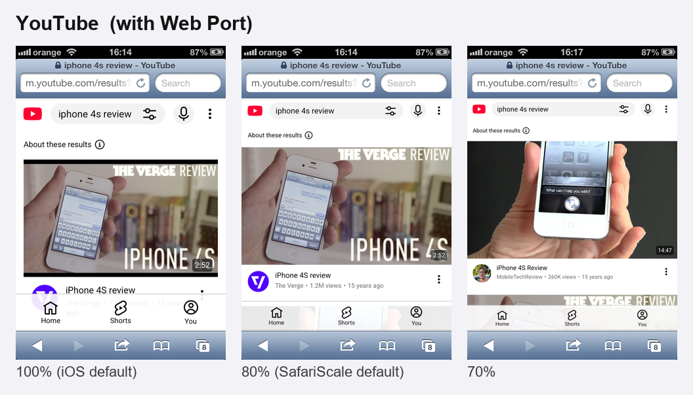
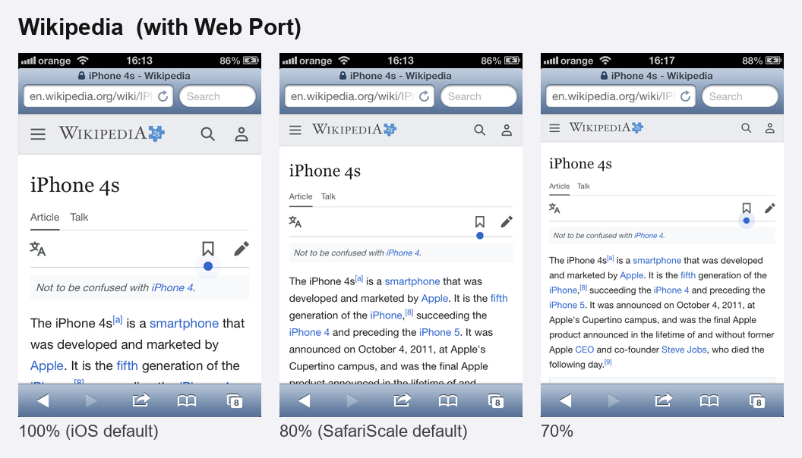
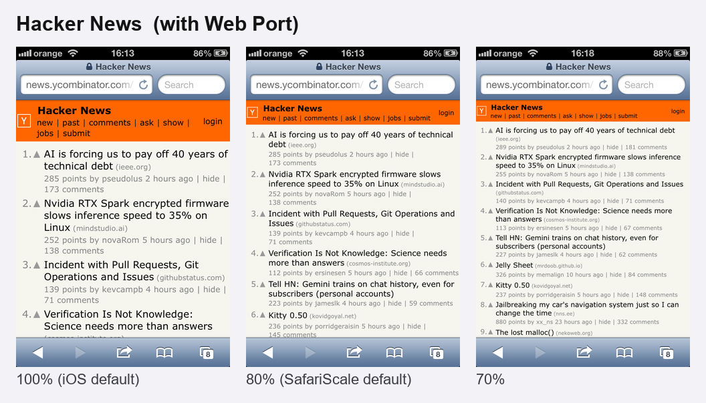
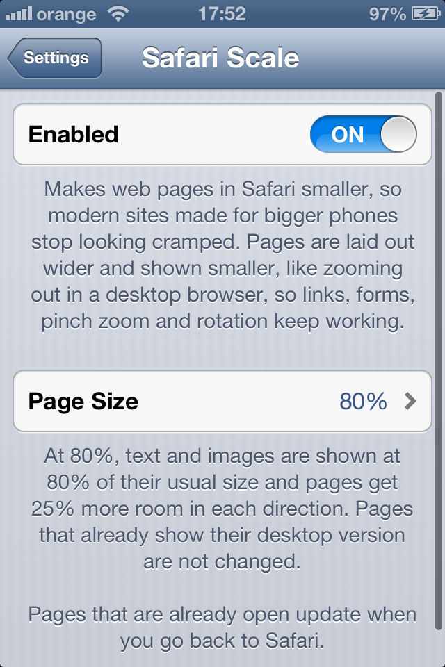

<p align="center"></p>

<h1 align="center">SafariScale (iOS 6)</h1>

**Makes web pages in Safari smaller on iOS 6.**

Modern websites are made for phones that are much bigger. On a 3.5-inch screen they look cramped: big text, huge buttons and very little on screen at once. SafariScale shows pages at 80% of their size by default, or anywhere from 30% to 100%, so more fits on the screen.

It works like zooming out in a desktop browser. The page gets a wider layout and is shown smaller. So nothing is cut off or broken: links, forms, menus, pinch zoom and rotation all keep working.

**Works with [Web Port](http://lululab.net/)**, lululab's modern WebKit for iOS 6, as well as with Safari's own engine. The two go well together: Web Port makes today's sites load and work again, and SafariScale gives them room on the small screen.

This is an unofficial jailbreak tweak. It is not affiliated with or endorsed by Apple.

## Features

- **Page Size:** 30% to 100% in steps of 10%: 80% is the default, 100% is the normal iOS size.
- **Only pages made for phones change:**
  - Sites that size themselves to the screen (almost every modern site) are shown smaller.
  - Desktop sites with no mobile layout and pages with a fixed width are left alone, because Safari already fits those to the screen.
- **A real layout, not a picture scaled down.** At 80% an iPhone page is laid out 400 px wide instead of 320 px, so the site's own CSS decides how to use the room, and scripts see the same width.
- **Open pages update in place** when you change the size in Settings and go back to Safari. Nothing reloads, and what you typed into forms stays.
- **Works with [Web Port](http://lululab.net/)** (lululab's modern WebKit for iOS 6) and with Safari's own engine. Nothing to set up: SafariScale works with whichever engine Safari is using, and Web Port's own zoom controls (long-press the toolbar) work on top of it.
- **Text stays in proportion.** iOS normally enlarges text it thinks is too small to read on a zoomed-out page, which would undo the change on many sites. SafariScale adjusts that too, so text shrinks along with everything else.
- Nothing is added to Safari itself. All settings are in the Settings app.

## Screenshots

iPhone 4S, iOS 6.1.3, with Web Port. Each site at 100% (iOS default), 80% (SafariScale default) and 50%. Google is the English version of Google Japan.









## Compatibility

- Tested on an iPhone 4S with iOS 6.1.3 and Cydia Substrate, with Web Port 1.0.0 and with Safari's own engine: every page size, switching sizes and turning it off and on with pages open.
- 200 pages in a row in one tab (two of every three sized to the device), on an emulated iPhone 4 with iOS 6.1.3, at 80%: memory flat after the first 70 pages (heap 3.5 to 3.9 MB, resident about 36 MB), one web view throughout.
- For iOS 6.x (armv7). It is limited to iOS 6 because that is what it has been tested on.
- Only Safari is changed. Other apps and home-screen web apps keep the normal size.

## Install

Add the **iOS Legacy** source to Cydia, then search for SafariScale:

```
https://itsallexb.github.io/ios-legacy/
```

One tap on your device: [Add to Cydia](https://itsallexb.github.io/ios-legacy/add/cydia.html)

Or download the `.deb` from [Releases](https://github.com/itsAllexB/SafariScale-iOS6/releases/latest) and install it with iFile or `dpkg -i`. Then close Safari from the app switcher and open it again.

Requires Cydia Substrate (`mobilesubstrate`) and PreferenceLoader. Both are on almost every iOS 6 jailbreak.

## Settings

Open **Settings > Safari Scale**:

- **Enabled**: turns the tweak on or off.
- **Page Size**: 30% to 100% in steps of 10%. 80% is the default.
- **About Safari Scale…**: how it works, on a page of its own.

The page is in English and Romanian.



## Build from source

You need [Theos](https://theos.dev/docs/installation) and the iOS 9.3 SDK from [theos/sdks](https://github.com/theos/sdks). It's the newest one that still builds armv7, which iOS 6 devices need.

```sh
git clone https://github.com/itsAllexB/SafariScale-iOS6.git
cd SafariScale-iOS6
make package FINALPACKAGE=1
```

The package is written to `packages/`. GitHub Actions builds it on every push (see [`.github/workflows/build.yml`](.github/workflows/build.yml)).

**How it works:** WebKit reads a page's `<meta name="viewport">` and gives UIKit the width and zoom values in a dictionary, through `-[UIWebDocumentView _applyViewportArguments:]`. For pages that size themselves to the device, SafariScale divides the width by the page size and multiplies the zoom values by it before UIKit uses them. At 80%, `width=device-width` becomes 400 instead of 320, and `initial-scale=1` becomes 0.8. Safari also gives WebKit a text autosizing width on every page load (`-[WebFrame _setTextAutosizingWidth:]`, the screen width); for scaled pages that's divided by the page size too, or WebKit would enlarge the text again. Calls into WebKit take the WebThread lock of the WebKit Safari is actually using (Web Port loads a second WebCore next to Apple's). See the comments in [`Tweak.x`](Tweak.x).

## Credits and license

Made by [AllexB](https://github.com/itsAllexB).

SafariScale is free software under the GNU General Public License v3.0 or later. See [LICENSE](LICENSE).

iPhone, iOS and Safari are trademarks of Apple Inc. This project is not affiliated with Apple.
